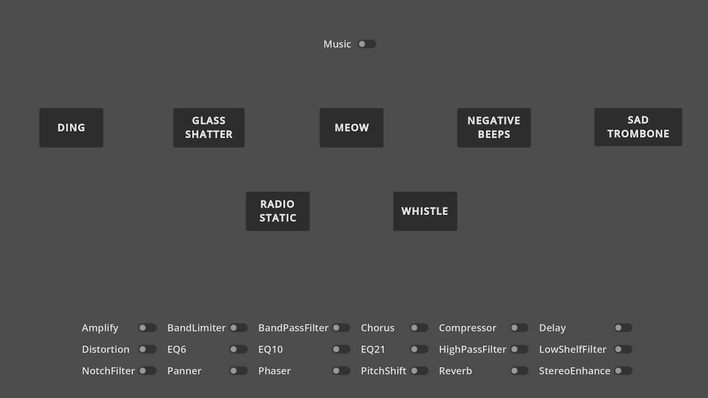
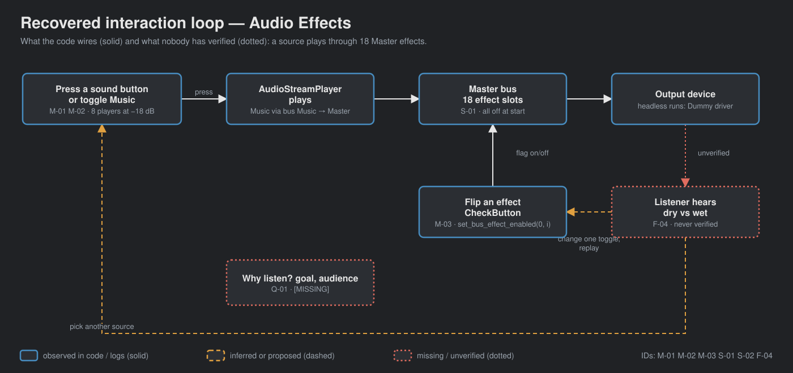
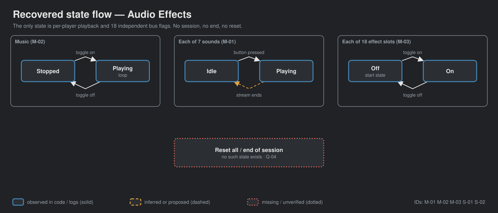

# walker-audio-audio-effects — Game Design Document (recovered)

| | |
|---|---|
| Version | 0.1.0-recovered |
| Date | 2026-09-27 |
| Author | Recovered by Zelda (/gdd reverse --path godot silent), for Nik Bear Brown |
| Mode | recovered, silent |
| Revision | 1 |
| Gates | vision ○ · systems ○ · world ○ · scope ○ — gate — unsigned at time of writing |
| Source | local adaptation of the Godot demo `audio/audio_effects` (Godot Engine contributors, MIT) |
| What this is | a **tech demo**, not a game |

Provenance tags: `[OBSERVED path:line]` the code or a local log shows this · `[INFERRED]` the code strongly implies this, evidence stated · `[MISSING]` nothing in the folder can tell us this. Paths are relative to the folder root. A recovered GDD describes what exists; it approves none of it. In the diagrams, observed elements are solid, inferred or proposed ones dashed, missing or unverified ones dotted.

*`[OBSERVED godot/screenshots/audio_effects.webp]` The screenshot that ships with the upstream demo. It is not a local Walker capture: no local capture exists (`CAPTURE-PLAN.md`: "Status: not recorded").*

## 1. Vision summary

**What the code is.** One screen: a Music toggle, seven one-shot sound buttons, and a six-column grid of eighteen CheckButtons, each enabling one effect on the Master bus `[OBSERVED godot/audio_effects.tscn:72-230; godot/default_bus_layout.tres:69-106]`. The project description calls it "a simple demo that showcases the various Audio Effects that can be used in Godot" `[OBSERVED godot/project.godot:14-15]`.

**Logline.** Press a sound, flip an effect, hear the difference. `[INFERRED from project.godot:14-15 and the button/toggle pairing; nothing states it as a goal]`

**Player / audience.** Godot learners studying audio buses `[INFERRED godot/README.md links the Audio buses and Audio effects manual pages]`. The Walker audience for this copy is not stated `[MISSING]`.

**Why it exists in Walker.** Local notes plan two narrated films that demonstrate the effects with "matched dry/wet examples" `[OBSERVED README.md; CAPTURE-PLAN.md]`. Whether the demo is teaching material, film source, or a seed for a game is not recorded `[MISSING]`.

**Biggest unresolved question.** What should a viewer be able to hear, and say, after using this? Q-01.

## 2. Design pillars

No pillars exist in the folder `[MISSING]`. What the code's structure protects, stated as `[INFERRED]` candidates only:

| ID | Candidate pillar | Evidence | Status |
|---|---|---|---|
| P-01 | One control, one effect | each CheckButton maps to exactly one bus-effect index `[OBSERVED godot/audio_effects.gd:39-108]` | `[INFERRED]` |
| P-02 | Same source, before and after | every sound and the music route through Master, where all effects sit `[OBSERVED godot/audio_effects.tscn:29-60; default_bus_layout.tres:107-112]` | `[INFERRED]` |
| P-03 | Honest audio evidence | the capture plan forbids substituting the dry WAV for the processed engine mix `[OBSERVED CAPTURE-PLAN.md]` | a Walker process rule, not a design pillar `[INFERRED]` |

## 3. Core loop

**Micro (seconds).** Pick a source (a sound button or the Music toggle) → pick one or more effect toggles → listen → change a toggle → listen again `[INFERRED from the scene layout; OBSERVED wiring godot/audio_effects.tscn:234-259]`. Deciding: which effect to hear on which source. Risk: none. Reward: an audible difference, which has never been verified locally `[OBSERVED FRICTIONAL.md 2026-09-20 00:52: "Headless Dummy audio playback state is not evidence of audible quality"]`.

**Meso / macro.** None. There is no session structure, goal, end state, score, or save `[OBSERVED: one script, 108 lines, no state beyond node playback and bus flags]`.

**Loop honesty test.** Strip the labels and this is a mixing console with 26 switches. It is a good instrument and not a game. `[INFERRED]`

## 4. Player Experience Goals

None recorded `[MISSING]`. Candidate goals, if this were designed on purpose, go to Q-01; recorded here only as `[INFERRED]` readings of the capture plan:

| ID | Candidate | Evidence | Tested by |
|---|---|---|---|
| PX-01 | The listener can tell dry from wet for a single effect | CAPTURE-PLAN.md comparison protocol step 2 | nothing yet `[MISSING]` |
| PX-02 | The listener understands effects stack in bus order | CAPTURE-PLAN.md step 6 | nothing yet `[MISSING]` |

## 5. Mechanics

### M-01 Play a one-shot sound `[OBSERVED]`
Seven Buttons (Ding, Glass, Meow, Beeps, Trombone, Static, Whistle) each call `play()` on their AudioStreamPlayer `[godot/audio_effects.gd:11-36; audio_effects.tscn:235-241]`. Players sit at −18 dB on the default (Master) bus `[audio_effects.tscn:34-60]`. Edge: pressing again restarts the sound; sounds overlap across buttons `[INFERRED from AudioStreamPlayer default polyphony]`.

### M-02 Toggle music `[OBSERVED]`
CheckButton "Music" starts/stops a looped music player at −18 dB on bus `Music`, which sends to Master `[audio_effects.gd:4-8; audio_effects.tscn:29-32,72-80; default_bus_layout.tres:107-112]`.

### M-03 Toggle one Master-bus effect `[OBSERVED]`
Eighteen CheckButtons call `AudioServer.set_bus_effect_enabled(0, index, pressed)` for indices 0–17 `[audio_effects.gd:39-108]`. All start disabled `[default_bus_layout.tres:72-106]`. Effects combine in bus order when several are on `[INFERRED from AudioServer bus processing; CAPTURE-PLAN.md step 6]`.

Recorded tuning values (source settings, not approved design) `[OBSERVED default_bus_layout.tres]`: Amplify +5 dB (line 5); BandLimitFilter cutoff 12020 Hz, gain 0.25 (9-10); LowShelfFilter gain 0.25 (17); Panner −1.0 (24); PitchShift 0.75 (31); StereoEnhance pan_pullout 2.0, time_pullout 20 ms, surround 0.2 (38-40); Compressor threshold −24 dB (50); Distortion pre_gain −26 dB, drive 0.5 (57-58). EQ6/EQ10/EQ21 have all 37 band gains at 0 dB `[OBSERVED FRICTIONAL.md 2026-09-20 01:55, test_eq_defaults.gd]`, so enabling them is designed to change nothing audible `[INFERRED]`.

## 6. Systems

### S-01 Master effect chain `[OBSERVED]`
Eighteen slots, a fixed order, each on/off. State lives in AudioServer, not in the script `[audio_effects.gd:40]`. Legibility: the CheckButton shows the flag; the sound shows the result. No reset control exists `[OBSERVED: no handler]`.

### S-02 Sources `[OBSERVED]`
Eight AudioStreamPlayers under `SoundEffects` `[audio_effects.tscn:27-60]`. No state machine; each player is independently playing or stopped.

## 7. Progression

None. The demo has no stages, unlocks, or difficulty `[OBSERVED]`. N/A for a tech demo; if this became a lesson, the progression question is Q-02.

## 8. World

N/A. There is no world, space, or fiction `[OBSERVED]`. The layout is a centred control panel `[audio_effects.tscn:17-26]`.

## 9. Narrative

N/A `[OBSERVED]`. No text beyond control labels. No lore is asserted here.

## 10. Characters

N/A `[OBSERVED]`.

## 11. Features and priority

| ID | Feature | Tag | Source | Status |
|---|---|---|---|---|
| F-01 | Seven one-shot sound buttons | CORE `[INFERRED]` | M-01 | exists; mouse activation verified headless 7/7 `[OBSERVED FRICTIONAL.md 00:52]` |
| F-02 | Music toggle | CORE `[INFERRED]` | M-02 | exists; start/stop verified headless `[OBSERVED FRICTIONAL.md 00:52]` |
| F-03 | Eighteen effect toggles | CORE `[INFERRED]` | M-03 | exists; bus flags toggle and restore 18/18 `[OBSERVED FRICTIONAL.md 00:20]` |
| F-04 | Audible dry/wet comparison | CORE for the films `[INFERRED CAPTURE-PLAN.md]` | — | not verified `[OBSERVED CAPTURE-PLAN.md "not recorded"]` |
| F-05 | Two narrated Walker films | — | README.md | pending `[OBSERVED README.md]` |

**CORE percentage.** Priority tags were never assigned `[MISSING]`; the tags above are inferred. By that reading 4 of 5 = 80%, which only says the demo is already minimal. Recorded, not acted on (Q-03).

## 12. Out of scope

Nothing is scoped out in writing `[MISSING]`. Observed absences: no effect parameter editing, no reset-all, no keyboard shortcuts beyond Godot's built-in UI focus, no presets, no visual meters `[OBSERVED audio_effects.gd]`. Whether any of these are wanted is Q-04.

## 13. Technical

Godot 4.7 features, GL Compatibility renderer, `run/low_processor_mode=true`, canvas_items stretch `[OBSERVED godot/project.godot:17-18,31-32,44-45]`. Local import and runs used Godot 4.7.2 headless `[OBSERVED FRICTIONAL.md 2026-09-19 23:17]`. Bus layout `default_bus_layout.tres` (Master + Music) `[project.godot:23]`. No `[input]` section: no custom input actions `[OBSERVED project.godot]`. No save/load, no scene transitions, one scene `[OBSERVED]`. Assets: 7 WAV + 1 OGG in `godot/sfx/` (L4, shipped third-party audio with credits in `godot/README.md`), one icon, one upstream screenshot. Tests added locally: `godot/test_bus_input.gd` (mouse-driven toggle/sound/music probe), `godot/test_eq_defaults.gd` (EQ band gains).

## 14. Risks

| ID | Risk | Evidence | Mitigation on record |
|---|---|---|---|
| R-01 | Flat EQs presented as an audible change | all 37 EQ bands at 0 dB `[OBSERVED FRICTIONAL.md 01:55]` | narration must say so `[OBSERVED CAPTURE-PLAN.md step 5]` |
| R-02 | Headless state checks mistaken for audio verification | Dummy driver only `[OBSERVED FRICTIONAL.md]` | explicit boundary in every log entry |
| R-03 | Music attribution dropped from a film | CC BY 3.0 track `[OBSERVED godot/README.md]` | attribution required in film and description `[OBSERVED CAPTURE-PLAN.md]` |
| R-04 | Normalizing dry/wet hides Amplify's +5 dB | `[OBSERVED CAPTURE-PLAN.md step 4]` | fixed gain between paired takes |

## 15. Open questions

Kept in `design/decisions.md`: Q-01 purpose and audience; Q-02 lesson progression; Q-03 priorities; Q-04 wanted additions (reset, parameters, meters); Q-05 EQ demonstration; Q-06 success criterion for the films.

## 16. Tests

Existing `[OBSERVED]`:

| ID | Script | Checks | Result on record |
|---|---|---|---|
| T-01 | `godot/test_bus_input.gd:22-28` | Amplify toggles and restores by mouse | pass `[FRICTIONAL.md 23:49]` |
| T-02 | `godot/test_bus_input.gd:29-41` | all 18 toggles change and restore their bus index | 18/18 `[FRICTIONAL.md 00:20]` |
| T-03 | `godot/test_bus_input.gd:42-54` | 7 sound buttons start their players; music starts/stops | 7/7, true/true `[FRICTIONAL.md 00:52]` |
| T-04 | `godot/test_eq_defaults.gd` | EQ6/10/21 band gains all 0 dB | 3/3 flat `[FRICTIONAL.md 01:55]` |

Proposed `[INFERRED from CAPTURE-PLAN.md]`: H-01 a listener identifies which single effect is on from a blind dry/wet pair; H-02 fixed-gain stereo capture of Panner and StereoEnhance shows channel difference. Neither exists.

## Zelda's notes (silent mode; what I would have said out loud)

**7 Failure Mode audit.**

| Mode | Rating | Note |
|---|---|---|
| Ghost Center | PRESENT | Expected. No vision, player, or purpose beyond the upstream one-line description. |
| Mechanic Mirage | PRESENT | Expected. The only "experience" candidates are capture-plan steps. |
| Implementation Void | PARTIAL | Happy paths are clear; overlapping sounds and stacked effects are unspecified. |
| Priority Inflation | PARTIAL | 80% CORE by inference, but only because the demo is tiny. |
| Novelist's Trap | ABSENT | No lore. Good. |
| Completeness Fallacy | PRESENT | Purpose, audience and success criteria live nowhere. |
| Stagnant Artifact | ABSENT | FRICTIONAL.md is a dated history. |

1. **This is an instrument, not a game.** Treat it as one. The design question is not "what is the core loop" but "what should someone be able to hear and name afterwards".
2. **Three of the eighteen toggles do nothing by design.** Flat EQs are fine in a code sample and misleading in a demonstration. Decide (Q-05) before anyone narrates them.
3. **First fix:** answer Q-01. Everything else follows from whether this is teaching material, film source, or a seed.
